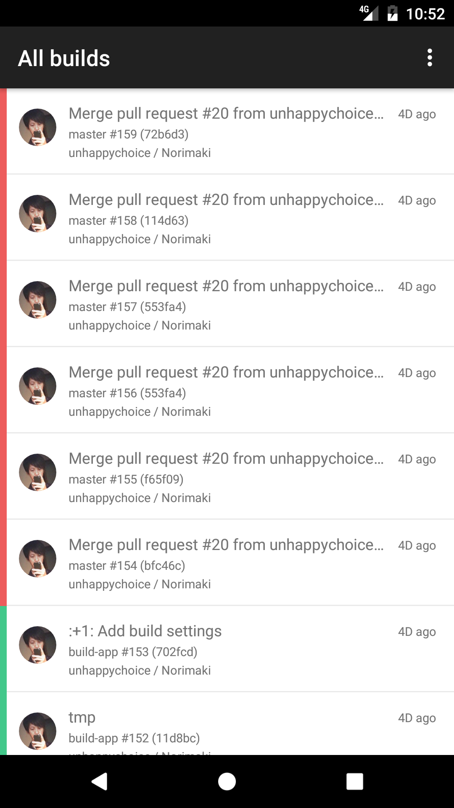

# Norimaki
[](https://play.google.com/store/apps/details?id=com.unhappychoice.norimaki)

[](https://github.com/circleci-tools/Norimaki/releases/latest)
[](https://circleci.com/gh/circleci-tools/Norimaki)
[](https://codecov.io/gh/circleci-tools/Norimaki)
[](https://libraries.io/github/circleci-tools/Norimaki)


Norimaki is a [CircleCI](https://circleci.com) client for Android.

## Features

- Browse recent builds across projects or view builds for a specific project.
- Inspect build steps, read their logs, and see other jobs in the same workflow.
- Rebuild from the build details screen, with an option to clear the cache first.

## Installation

- **Google Play:** Install [Norimaki](https://play.google.com/store/apps/details?id=com.unhappychoice.norimaki).
- **From source:** Install JDK 21, Android SDK Platform 37.0, and Android SDK Build Tools 37.0.0. Start an Android emulator or connect an Android device with USB debugging enabled. The device or emulator must run Android 6.0 (API 23) or later. From the repository root, build and install the debug app:

  ```sh
  ./gradlew installDebug
  ```

## Quick start

1. [Install Norimaki](#installation).
2. Create a [personal API token](https://circleci.com/docs/guides/toolkit/managing-api-tokens/#create-a-personal-api-token) for your CircleCI account.
3. Open Norimaki, paste the token into the token field, and tap **Apply**.
4. Tap a build in **Recent Builds** to see its details.

## Configuration

To replace your CircleCI personal API token, open the build list's overflow menu, select **Change API Token**, enter the new token, and tap **Apply**. Norimaki verifies the token with CircleCI before saving it on the device. If verification fails, check your connection and confirm that the token is still valid, then try again.

Norimaki excludes the saved token from Android backups and device transfers. Enter your token again after restoring the app from a backup or moving to another device.

## Running tests

With JDK 21, Android SDK Platform 37.0, and Android SDK Build Tools 37.0.0 installed, run the full unit test suite from the repository root:

```sh
./gradlew testDebugUnitTest
```

Run `python3 scripts/test-gradle-wrapper.py` to verify that the Wrapper rejects a ZIP with a mismatched checksum. This test uses a local ZIP and requires a JDK and Python 3.

Set `CODECOV_TOKEN` in the CircleCI project environment variables. The test job requires a successful Codecov upload and fails if the token is unset or empty.

## Release checklist

- When upgrading the Gradle Wrapper, update `distributionSha256Sum` in `gradle/wrapper/gradle-wrapper.properties` with the [official SHA-256 checksum](https://gradle.org/release-checksums/) for the exact distribution in `distributionUrl`.
- When updating `versionName` in `app/build.gradle`, update `app/src/main/play/release-notes/en-US/production.txt` with the user-facing changes for that version before tagging it.
- Before pushing the tag, set these environment variables in the CircleCI project's settings for the deploy job:

  | Variable | Value |
  | --- | --- |
  | `RELEASE_KEYSTORE_BASE64` | Base64-encoded contents of the release signing keystore file. |
  | `RELEASE_KEYSTORE_PASSWORD` | Password for the release signing keystore. |
  | `RELEASE_KEYSTORE_KEY_ALIAS` | Alias of the signing key in the keystore. |
  | `RELEASE_KEYSTORE_KEY_PASSWORD` | Password for the signing key. |
  | `PLAY_ACCOUNT_JSON_BASE64` | Base64-encoded contents of the Google Play service account JSON key file. |

- Before pushing the matching `v<versionName>` tag, update `app/src/main/play/release-notes/en-US/internal.txt` for internal testers and run `bash scripts/ci/test-play-deploy.sh`. The tagged CircleCI job publishes the APK to the `internal` track with those notes. The check runs without Play credentials or an APK upload.
- After internal testing passes, promote the tested APK in [Play Console](https://support.google.com/googleplay/android-developer/answer/9859348). Create a Production release and use **Add from library** to select the same APK by version code. Paste the tagged version's `production.txt` into the English (United States) release notes before reviewing and rolling out the production release.

## Author

[@unhappychoice](https://unhappychoice.com)

Logo, app icons are designed by [Carlos Liu](https://github.com/morita7453)

## Screenshot


